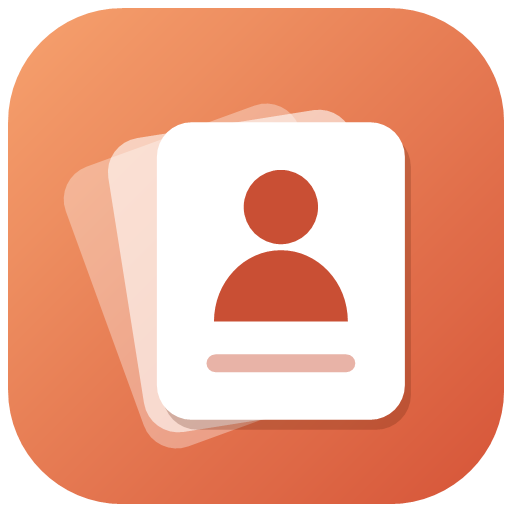

<p align="center">
  
</p>

<h1 align="center">AccountDeck</h1>

<p align="center">
  Run several accounts of the same Windows app side by side, and switch between them in one keystroke.
</p>

<p align="center">
  
  
  
</p>

---

AccountDeck gives every account its own data folder, so each sign-in keeps its own session, cookies and settings. It works with Claude Desktop, Chromium browsers, VS Code, Firefox and Telegram, and with any other desktop app you add yourself. The app is a small native utility that runs from the system tray. It uses about 16 MB of memory and opens in well under a second.

## Contents

- [Features](#features)
- [Requirements](#requirements)
- [Installation](#installation)
- [Getting started](#getting-started)
- [How account isolation works](#how-account-isolation-works)
- [Claude conversations](#claude-conversations)
- [Keyboard shortcuts](#keyboard-shortcuts)
- [Configuration](#configuration)
- [Building from source](#building-from-source)
- [Uninstalling](#uninstalling)
- [Troubleshooting](#troubleshooting)
- [Privacy](#privacy)
- [License](#license)

## Features

| | |
| --- | --- |
| **Manager window** | Your apps are listed on the left. Each account of the selected app appears as a card that shows whether it is running. |
| **Quick switcher** | Press `Ctrl+Alt+A` anywhere, type part of an app or account name, then press `Enter`. If that account is already open, its window comes to the front; otherwise the account starts. |
| **Tray menu** | Every app and account is one click away. You can also turn on start-with-Windows and other options here. |
| **Scan PC** | Finds installed apps and groups them by how well they support several accounts. |
| **Desktop shortcuts** | Create one per account, each with its own coloured icon. |
| **Any app** | Pick a preset or any `.exe`, then choose how its accounts are kept apart. |
| **Claude conversations** | Imports Claude's official data export from your Downloads folder. You can browse and search the chats, and carry any conversation over to another account. |

## Requirements

- Windows 10 (1809 or later) or Windows 11, 64-bit.
- If you use the **standard** download, you also need the [.NET 9 Desktop Runtime](https://dotnet.microsoft.com/download/dotnet/9.0). Windows offers to install it the first time you start AccountDeck. The **portable** download already includes everything it needs.

## Installation

### Option 1: Download a release (recommended)

1. Open the [Releases](../../releases) page and download one of the two packages:

   | Package | Size | Notes |
   | --- | --- | --- |
   | `AccountDeck-<version>-win-x64-portable.zip` | ~41 MB | Includes the .NET runtime, so it runs on any PC. |
   | `AccountDeck-<version>-win-x64.zip` | < 1 MB | Requires the .NET 9 Desktop Runtime. |

2. Extract the zip into a folder of your choice, for example `%LOCALAPPDATA%\Programs\AccountDeck`.
3. Run `AccountDeck.exe`.
4. *(Optional)* Right-click the tray icon and choose **Start with Windows**.

> **Windows SmartScreen.** The binaries are not code-signed yet, so the first time you run AccountDeck, Windows may show *"Windows protected your PC"*. Click **More info → Run anyway**. You can check the download against `SHA256SUMS.txt`, which is published with each release:
>
> ```powershell
> Get-FileHash .\AccountDeck-<version>-win-x64-portable.zip -Algorithm SHA256
> ```

### Option 2: Build it yourself

See [Building from source](#building-from-source).

## Getting started

1. **Start AccountDeck.** On the first run it detects supported apps that are already installed (for example Claude, Chrome and Edge) and adds them, each with a **Default** account. The Default account is your normal, existing sign-in.
2. **Add more apps**, if you need them. Click **Scan PC** to see what else is installed, or **+ Add app** to pick any program by hand.
3. **Create an account.** Select an app, click **+ New account**, type a name such as *Work*, then click **Create**. AccountDeck creates a separate data folder for that account automatically.
4. **Open it.** Click the card. The app starts with an empty profile, so you can sign in with a different account. Your Default account keeps running alongside it.
5. **Switch quickly.** Press `Ctrl+Alt+A`, type `work`, then press `Enter`.

## How account isolation works

Each app uses one isolation mode. Presets set this for you; for custom apps you choose the mode in **App settings**.

| Mode | Typical apps | What AccountDeck does |
| --- | --- | --- |
| Chromium / Electron | Claude, Chrome, Edge, Brave, Vivaldi, VS Code, most Electron apps | Starts the app with `--user-data-dir="<account folder>"` |
| Firefox profile | Firefox | Starts the app with `-profile "<account folder>" -no-remote` |
| Redirect AppData | Classic desktop apps | Sets `APPDATA` and `LOCALAPPDATA` to folders inside the account folder |
| Custom arguments | Anything else | Uses your own arguments and environment variables; `{dataDir}` is replaced by the account folder |

**Limitations.**

- Some apps allow only one running copy, whatever data folder they use. With those apps you can switch accounts, but you cannot run two accounts at once.
- Game launchers and games with anti-cheat (for example Steam or Riot Client) may refuse to start under a redirected profile.

## Claude conversations

Claude stores your chats on its servers, not on your PC. AccountDeck reads them only from Claude's **official data export**.

1. In Claude, signed in as the account whose chats you want, open **Settings → Privacy → Export data**. Claude e-mails you a download link.
2. Save the `.zip` file to your **Downloads** folder. AccountDeck detects it and imports it automatically.
   - If an account's **Note** contains the export's e-mail address, the export is imported into that account straight away.
   - Otherwise, a notification asks you which account the export belongs to.
3. Open the account's **⋯** menu and choose **Conversations (from export)…**. From there you can search the chats, copy a conversation as Markdown, save it as a `.md` file, or click **Copy to continue in another account** and paste the result as the first message of a new chat.

You can turn automatic import off in the tray menu.

## Keyboard shortcuts

| Keys | Action |
| --- | --- |
| `Ctrl+Alt+A` | Open the quick switcher (works anywhere) |
| `Alt+1` … `Alt+9` | Open the n-th account of the selected app |
| `Ctrl+1` … `Ctrl+9` | Select the n-th app |
| `Ctrl+N` | New account |
| `Ctrl+Shift+N` | New app |
| `Ctrl+F` | Filter accounts |
| `F5` | Refresh running status |
| `Esc` | Clear the filter, or hide the window |

## Configuration

All settings are stored in `%APPDATA%\AccountDeck\config.json`. Quit AccountDeck from the tray menu before you edit this file by hand.

| Setting | Default | Description |
| --- | --- | --- |
| `QuickSwitchHotkey` | `"Ctrl+Alt+A"` | Global shortcut for the quick switcher, for example `"Ctrl+Shift+Space"`. |
| `HideAfterLaunch` | `true` | Hide the manager window after it opens an account. |
| `CloseToTray` | `true` | Closing the window keeps AccountDeck running in the tray. |
| `AutoImportClaudeExports` | `true` | Watch the Downloads folder for Claude data exports. |

Other files in the same folder:

| Path | Contents |
| --- | --- |
| `data\` | Default location of account data folders. Claude accounts use `%APPDATA%\Claude-<name>` instead. |
| `exports\` | Imported Claude conversations. |
| `icons\` | Icons used by desktop shortcuts. |
| `errors.log` | Error details, created only if something goes wrong. |

Per-account options are under **Advanced options** when you create or edit an account:

- Custom data folder
- Use the app's normal sign-in
- Extra arguments
- Extra environment variables, for example `CLAUDE_CONFIG_DIR` to keep Claude Code settings separate per account

## Building from source

Requirements: [.NET 9 SDK](https://dotnet.microsoft.com/download/dotnet/9.0) on Windows.

```powershell
git clone https://github.com/duynt-dev/account-deck.git
cd account-deck
dotnet run --project src/AccountDeck
```

To create the release packages (written to `artifacts/`):

```powershell
.\scripts\build-release.ps1
```

## Uninstalling

1. Right-click the tray icon and choose **Exit**. If you turned on **Start with Windows**, turn it off first.
2. Delete the folder that contains `AccountDeck.exe`.
3. *(Optional)* Delete the following:
   - `%APPDATA%\AccountDeck`, which holds the settings and imported conversations.
   - Any desktop shortcuts that AccountDeck created.

Account data folders are **never** deleted automatically, because they contain your sign-ins. Delete them by hand only if you no longer need those accounts.

## Troubleshooting

| Problem | Fix |
| --- | --- |
| The quick-switch shortcut does nothing | Another app already uses that shortcut. Set a different `QuickSwitchHotkey` in the config file and restart AccountDeck. |
| An account opens the window of another account | The app enforces a single instance. Close the app completely, then open the account you want. |
| "Program not found" | Open **App settings** and point **Program** at the app's `.exe`. |
| A Claude export is not detected | Make sure the `.zip` is in your Downloads folder and that automatic import is turned on in the tray menu. You can also import it by hand from the **Conversations** window. |
| Something crashed | Check `%APPDATA%\AccountDeck\errors.log` and include its contents when you report the issue. |

## Privacy

- AccountDeck runs entirely on your PC. It has no telemetry and makes no network requests.
- It never reads, copies or reuses the cookies or sign-in tokens of the apps it starts.
- Claude conversations are read only from the export files that you download yourself.

## License

Released under the [MIT License](LICENSE). © 2026 duynt-dev.

AccountDeck is an independent project. It is not affiliated with Anthropic, Google, Microsoft, Mozilla or any other app vendor mentioned here.
